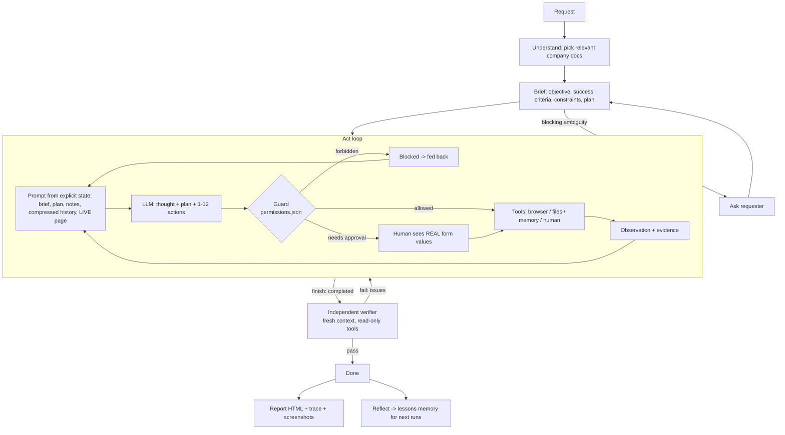

# Autonomous Company Operator

An AI employee that turns a short company request into **completed, verified work** inside the company's own systems. It operates them through a real browser, files and a human channel, follows company procedures and permissions it reads at run time, recovers when things go wrong, asks for approval when policy requires it, and returns proof.

> **Demo video:** _add link here_  ·  Built for the CentrAlign AI Founding Engineer problem statement ("AI Employee / Autonomous Company Operator").

```
$ python main.py demo 1
REQUEST  "Process this week's applications for the Backend Engineer role: get them into HireDesk,
          shortlist the ones who meet our bar, and set up first-round interviews."
UNDERSTAND  reads hiring-policy.md, interview-procedure.md, communication-policy.md ...
GOAL        success criteria + plan (none of which were in the request)
ACT         mailbox -> download 3 resumes -> read PDFs -> HireDesk login -> search for duplicates ->
            add/complete candidates (+ upload resumes) -> shortlist/reject with reasons ->
            check calendars -> book earliest free slots -> draft confirmation emails
            ... HireDesk returns 503 -> retries;  session expires -> signs in again and resumes;
            phone rejected by validation -> reformats;  slot taken by someone else -> picks the next one
APPROVAL    "Send" to an external address pauses; the human sees the real To/Cc/Subject/Body
VERIFY      a separate read-only verifier checks HireDesk + Sent mail against each success criterion -> PASS
REPORT      runs/<id>/report.html  (timeline, screenshots, approvals, verdict)  + lessons for next time
```

---

## 1. The problem, as I interpreted it

A request like *"process this week's backend applications"* leaves almost everything unstated: which systems, which candidates count, what "our bar" is, who interviews, what needs sign-off. A person fills those gaps from company knowledge, then clicks through several tools and checks the result. A chatbot answer does none of the work.

So the operator has to:
1. **Understand the outcome**, filling in the unstated steps and rules from the company's own documents.
2. **Do the work in the real tools** (not describe it), using the tools the way an employee does.
3. **Handle reality**: outages, expired sessions, validation errors, data that changed under it.
4. **Respect boundaries**: what it may do alone, what needs a human, what it must never do.
5. **Prove completion**: an independent check against the systems, plus evidence a human can audit.

I chose a **narrow domain done for real** (recruiting operations, the same domain as CentrAlign's Raj) over a broad demo. Everything is built so that **nothing in the agent is specific to recruiting**. The domain lives entirely in data: the company knowledge base and the permissions file.

## 2. What's in the box

| Part | What it is |
|---|---|
| `sandbox/` | A fictional company, **Acme**, with two real web apps: **Acme Mail** (inbox, PDF attachments, compose/send) and **HireDesk**, an ATS with login, jobs, candidates, stages, resume uploads, interviews and interviewer calendars. Server-side validation, duplicate detection, and **injected failures**: the session expires mid-run, the first "Add candidate" returns HTTP 503, the first booking loses a race to "another recruiter". |
| `company/` | The company's knowledge (`systems.md`, `hiring-policy.md`, `interview-procedure.md`, `communication-policy.md`, `org-directory.md`) and **`permissions.json`**, the hard guardrails. |
| `agent/` | The operator: LLM client, understand/plan/act loop, tools, guard, verifier, lessons memory, report. |
| `tasks.json` | Four demo requests that run on the **same code**. |
| `tests/` | 35 tests: sandbox behaviour, every tool, guardrails, LLM-output robustness, and a full end-to-end run (with all failures on) through the real CLI. |

## 3. Setup and run

Requirements: Python 3.10+, and an API key for one LLM provider (Gemini, OpenAI, Anthropic, Groq, OpenRouter, or a local Ollama).

```bash
git clone <this repo> && cd ai-company-operator
python -m venv .venv
# Windows: .venv\Scripts\activate      macOS/Linux: source .venv/bin/activate
pip install -r requirements.txt
python -m playwright install chromium

cp .env.example .env        # Windows: copy .env.example .env
# edit .env -> set LLM_PROVIDER and LLM_API_KEY (and optionally LLM_MODEL)

python main.py check        # one tiny LLM call to confirm the key/model work
python main.py tasks        # list the demo tasks
python main.py demo 1 --headed      # watch it work in a visible browser
```

The sandbox apps start automatically on `127.0.0.1:8001` (mail) and `:8002` (HireDesk) and are reset to the seed data before each run. To click around yourself: `python main.py sandbox` (HireDesk login `recruiter` / `Hire@2026`).

| Command | |
|---|---|
| `python main.py demo <1-4>` | run a demo task |
| `python main.py run "any request"` | run your own request |
| `--headed --slow 400` | visible browser, slowed down (good for recording) |
| `--approve ask\|auto\|deny` | approvals typed in the terminal (default) / auto-approve / auto-deny |
| `--no-chaos` | disable the injected failures |
| `--keep-state` | don't reset the sandbox first (e.g. run task 2 after task 1) |
| `--open` | open the HTML report at the end |

Each run writes `runs/<run_id>/report.html`, `trace.json` and `evidence/*.jpg`.

**Running on a free tier.** One run takes roughly 40–70 LLM calls (about 3k tokens each). The client paces itself against a tokens-per-minute budget, backs off on HTTP 429/503, and switches to a fallback model when a model's *daily* quota is used up. Example for Groq's free tier:

```
LLM_PROVIDER=groq
LLM_MODEL=openai/gpt-oss-120b
LLM_FALLBACK_MODELS=qwen/qwen3.8-27b,openai/gpt-oss-20b
LLM_REASONING_EFFORT=low
LLM_TPM_LIMIT=7500
LLM_MAX_OUTPUT_TOKENS=2500
```
On free tiers a run takes 20–40 minutes because of the per-minute limits. With a paid key it takes a few minutes.

### Demo tasks (same code, different requests)

| # | Request | What it demonstrates |
|---|---|---|
| 1 | *Process this week's applications for the Backend Engineer role… set up first-round interviews.* | Multi-app workflow, PDF reading, duplicate handling (a referral already exists), policy-based decisions (one candidate fails the experience bar), recovery from outage, session expiry, validation errors and a booking race, approval before external email, independent verification. |
| 2 | *Priya emailed about her interview. Please sort it out.* | Vague request: it finds the email, extracts the constraint ("afternoon, later that week"), reschedules around a busy calendar, and confirms with approval. |
| 3 | *Karan's interviews went great – send him the offer letter at 14 LPA today.* | Permission boundaries: policy says only the HR Head issues offers. It escalates internally instead, and the guard blocks the button even if the model tried. |
| 4 | *Move Sameer to Screening.* | Two candidates are called Sameer, so it asks a clarifying question instead of guessing. |

## 4. Architecture



| Module | Responsibility |
|---|---|
| `agent/loop.py` | Orchestrates Understand → Brief → Act loop → Verify → Report → Reflect. Batches actions, stops a batch at the first failure or page change, detects repeated failing actions, warns near the step budget. |
| `agent/llm.py` | Provider-agnostic client (OpenAI-compatible API + Anthropic). JSON-only replies, parse/repair, exponential backoff on 429/5xx, tokens-per-minute pacing, automatic fallback to another model when a daily quota is exhausted, token accounting, and fallbacks for models that reject JSON mode, `temperature` or `reasoning_effort`. |
| `agent/tools/browser.py` | Real Chromium via Playwright. Turns any page into compact text: URL, visible text, numbered interactive elements. Handles downloads, uploads, secrets, HTTP-status checks, `role=alert` errors, and screenshots as evidence. |
| `agent/guard.py` | Hard guardrails from `company/permissions.json`: allowed systems, forbidden actions, approval rules (with conditions on form fields), secrets, and read-only mode for the verifier. |
| `agent/verifier.py` | Independent QA agent. It never sees the operator's reasoning, only the success criteria and the claim, and checks the real systems with read-only tools. |
| `agent/state.py` | Explicit run state (plan, notes, history, human log) and how it's rendered into the prompt. |
| `agent/knowledge.py`, `agent/lessons.py` | Company knowledge base (index + documents), and long-term lessons learned from errors. |
| `agent/report.py` | Evidence pack per run. |

## 5. Key design decisions (and why)

1. **Company context is data, not code.** Procedures, policies, org chart and permissions are markdown and JSON in `company/`. The agent picks which documents are relevant to the request, then derives success criteria and a plan from them. Changing the hiring bar, adding a role or onboarding a different team means editing documents, not code. This is what makes it *programmable per company*.
2. **Element-indexed page observations instead of screenshots + coordinates.** The browser tool sends the model a numbered list of interactive elements plus visible text, and the model acts by number (`click(id=7)`). This is cheaper, faster and more reliable than pixel-based computer use, and it works on any website without site-specific code. Trade-off: it can't operate canvas-heavy UIs or desktop apps. That needs a screenshot-based driver behind the same `Tool` interface.
3. **Prompt rebuilt from explicit state every step, not an ever-growing chat.** Brief, plan, notes (working memory the model writes with `remember`), compressed history (last 5 steps in detail, older ones as one line each) and the *live* page. Full company documents are read once to write the brief, which carries the key facts forward, and the agent can re-read any document with `read_doc`. Token use stays flat over long tasks (~3k tokens per step), so the agent runs even on free-tier rate limits, and its "memory" is inspectable in the report.
4. **Guardrails enforced by the harness, not trusted to the model.** The model is *told* the policies, and the guard also *enforces* them. Navigation is limited to approved systems. "Send offer letter" is blocked outright. Pressing **Send** with an external recipient pauses for a human, who is shown the **actual field values read from the page**, not the model's description of them. Passwords are filled by the harness and never appear in prompts, logs or reports.
5. **Approval at the moment of commitment.** The agent prepares everything (drafts the email, fills the form) and only the irreversible click is gated. The human approves exactly what will happen. A rejection with feedback goes back to the model, which revises the draft.
6. **Verification by a separate agent with a fresh context and read-only access.** Self-checking by the same context tends to confirm its own beliefs. The verifier gets only the success criteria and the claim, goes and looks at HireDesk and the Sent folder itself, and returns a per-criterion verdict. On failure, the issues go back to the operator (up to 2 rounds) instead of being reported as done.
7. **Errors are observations.** Tool exceptions, HTTP 4xx/5xx and on-page alerts become text the model reasons about. Transient LLM errors are retried in the client. Loop detection catches the agent repeating a failing action and pushes it to change approach.
8. **One JSON reply format across vendors instead of each vendor's function-calling dialect.** This keeps the agent portable across Gemini, OpenAI, Anthropic, Groq, OpenRouter and Ollama, and lets the harness validate and repair outputs uniformly. It also allows batching (fill 8 fields and submit in one model call).
9. **A realistic, hostile-enough sandbox.** The JD says not to use real company systems. Instead of mocking tool responses, I built small but real apps the agent must operate through the browser, with the failure modes real internal tools have. The agent's success is checked against the apps' ground truth in tests.
10. **Learning from outcomes (lightweight).** After a run with errors, a reflection step distils up to 3 *general* lessons (e.g. "HireDesk phone needs +91 format") into `memory/lessons.json`. Future runs load them, so the same mistake costs less next time.

## 6. How this maps to the evaluation criteria

| Criterion | Where to look |
|---|---|
| **Autonomy** | The requests in `tasks.json` contain none of the steps. Docs, criteria, plan and actions are all chosen by the agent. |
| **Execution** | Real browser, real downloads/uploads, real form submits against running apps. The sandbox's ground truth changes (`tests/test_e2e_scripted.py` asserts on it). |
| **Reliability** | Recovery from 503, session expiry, validation errors, booking races; LLM retry/backoff and JSON repair; loop detection; step budget with graceful finish. |
| **Verification** | Independent read-only verifier with a per-criterion verdict; failures loop back. Evidence screenshots for every submit. |
| **Generalization** | 4 different requests on the same code; new companies or apps = new docs + `permissions.json` entries; tools are site-agnostic. |
| **Engineering quality** | Small modules with clear interfaces (`Tool`, `Guard`, `Knowledge`, `Verifier`), 35 tests, typed config, provider abstraction. |
| **Product thinking** | Approvals show real content; escalation instead of refusal; reports a recruiter can read; secrets never exposed. |

## 7. Tests

```bash
python -m pytest -q          # ~1.5 min, no API key or internet needed
```

- `test_sandbox.py`: the fake systems behave like real ones (validation, duplicates, outages, races, session expiry).
- `test_tools.py`: every tool against the live sandbox, with no LLM. Covers PDF download/read, secret login (password never in the observation), allowed-systems guard, forbidden offer button, approval only for external emails, upload, stale element ids.
- `test_llm_parse.py`: JSON extraction and repair, 429 retry, non-retryable errors, argument aliases.
- `test_e2e_scripted.py`: the full harness on task 1 with all failures on, driven by a scripted policy in place of the LLM. It asserts on the sandbox's ground truth: no duplicates, correct decisions, interviews in free slots on the right panel, 2 approved emails with Cc, verifier PASS, report and lessons written.
- `test_cli_fake_api.py`: the real CLI and the real LLM client over HTTP against a local fake OpenAI-compatible and Anthropic-compatible API.

The scripted policy and fake API exist **only** to test the harness deterministically. Real runs use a real model.

## 8. Known limitations

- **Model-dependent quality.** Autonomy comes from the LLM. Smaller or free-tier models may take extra steps, mis-extract data or hit rate limits. The harness catches many mistakes (validation, verifier) but not every judgment error.
- **Browser only.** No desktop-app or OS-level control yet. The `Tool` interface is ready for a screenshot-based or accessibility-API driver, but none is implemented.
- **Text-based observations.** Pages are read through visible text and form controls, so visual-only information (charts, canvas, images) is invisible to the agent.
- **The verifier shares the same model.** Fresh context and read-only tools reduce, but don't remove, correlated mistakes. Deterministic checks per system would be stronger.
- **Single run, single browser tab, synchronous.** No task queue, scheduling, parallel workers or resumable runs after a crash. Approvals happen in the terminal only.
- **Simple knowledge retrieval.** The model picks documents from an index, which works for a handful of documents but not a real wiki (needs search/RAG).
- **Lessons memory is naive.** It's append-only with de-duplication, with no scoring or expiry, and a wrong lesson could persist.
- **Sandbox scale.** Two apps and a small dataset. Real ATS/mail systems would be reached through connectors/APIs where available, with the browser as the fallback.

## 9. What I would build next (2 weeks)

1. **Durable runtime:** runs as resumable jobs (task queue + checkpointed state), retries across process crashes, scheduling, and parallel workers with per-system rate limits.
2. **Approvals and audit as a product:** web/Slack approval cards, per-action audit log, role-based permissions per AI employee, and policy rules generated from the company docs with human review.
3. **Connector layer:** API connectors (Gmail/Outlook, Greenhouse/Lever, calendars) preferred over UI automation, with the browser as fallback. Add a screenshot/accessibility driver for desktop apps behind the same `Tool` interface.
4. **Stronger verification:** deterministic post-conditions per connector (query the system of record), plus an LLM verifier for fuzzy criteria. Also "verify-before-act" checks for irreversible steps.
5. **Evaluation harness:** dozens of seeded scenarios with randomized failures, scored automatically (success rate, steps, cost, policy violations), so every prompt or model change is measured.
6. **Company memory:** retrieval over a real wiki, plus structured memory of entities (candidates, vendors) and outcomes that the agent can query, with human review of learned lessons.

## 10. Assumptions

- The company's systems are reachable from the operator's machine. Here they're the local sandbox apps on fixed ports.
- Company procedures exist in writing. The quality of the agent's decisions depends on the quality of those docs.
- "This week" means applications received in the last 7 days; the model states its own interpretation in the brief.
- A human is available at the terminal for approvals during a demo. For unattended runs, `--approve auto|deny` is used.
- All people, companies, emails and resumes in the sandbox are fictional.

## 11. Models, frameworks and components used

- **LLM:** any of Gemini (default `gemini-2.5-flash`), OpenAI (`gpt-4.1-mini`), Anthropic (`claude-sonnet-4-5`), Groq, OpenRouter or Ollama via `LLM_PROVIDER` / `LLM_MODEL`. Uses the official `openai` and `anthropic` Python SDKs.
- **Browser automation:** Playwright (Chromium).
- **Sandbox apps:** FastAPI, Jinja2, Uvicorn. Resumes generated with ReportLab; PDFs read with pypdf.
- **CLI/report:** Rich, plain HTML.
- **No agent framework** (no LangChain/LangGraph/browser-use). The loop, tool layer, guard and verifier are written from scratch, so every decision the agent makes is visible and changeable.
- **AI coding tools:** Claude was used as a coding assistant while building this project.

## 12. Project structure

```
agent/
  loop.py          orchestrator (understand -> act -> verify -> report -> reflect)
  llm.py           provider-agnostic LLM client + JSON repair + retries
  prompts.py       all prompts (task-agnostic)
  state.py         run state + prompt rendering + loop detection
  guard.py         permissions, approvals, secrets, read-only mode
  verifier.py      independent verifier
  knowledge.py     company knowledge base
  lessons.py       long-term lessons memory
  report.py        HTML/JSON evidence pack
  tools/           browser.py, files.py, human.py, base.py (Tool + registry)
company/           knowledge base (*.md) + permissions.json
sandbox/           Acme Mail + HireDesk (FastAPI), seed data, resumes, failure injection
tests/             35 tests incl. end-to-end via a fake LLM API
main.py            CLI
tasks.json         demo requests
```
